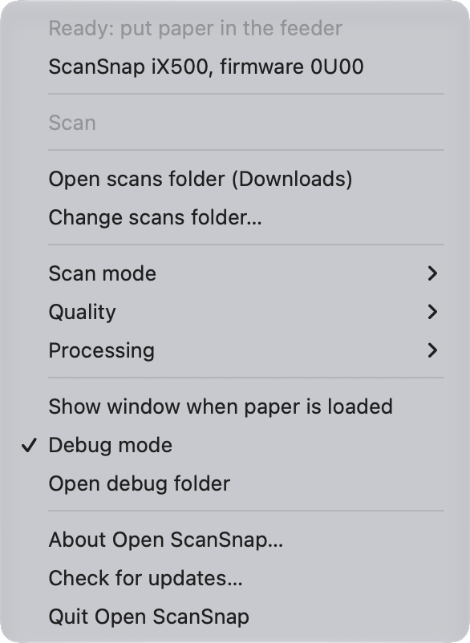
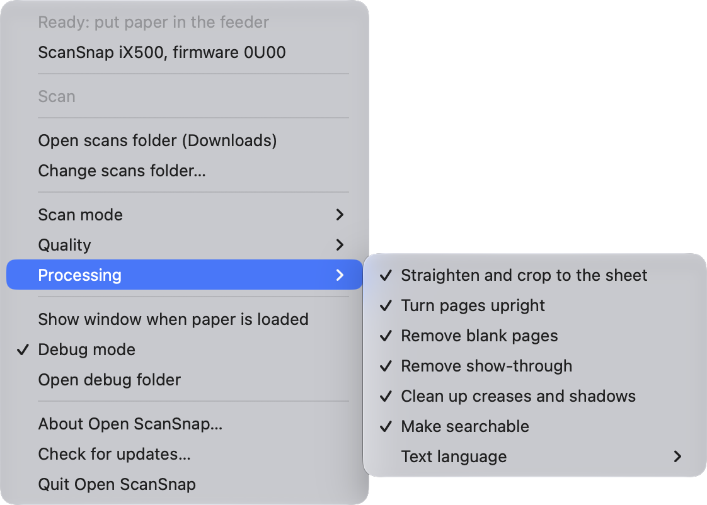
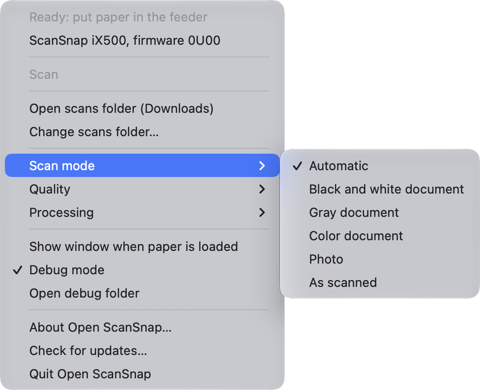

# Open ScanSnap

Scan from a ScanSnap iX500 on your Mac, over Wi-Fi or USB, without ScanSnap
Home.

  
  

## Features

- Lives in the menu bar; press the scanner's Scan button, or choose Scan.
- Makes one searchable PDF per batch, in your Downloads folder (or a folder
  you choose).
- Straightens and crops each page, turns it upright, and leaves out blank
  pages.
- Stores text pages in black and white, and keeps color where there is color.
- Removes the other side's print showing through the paper, and the shadows
  of folds.
- Reads text in 36 languages.
- Works over Wi-Fi or with the USB cable, and sets up the scanner's Wi-Fi.
- Updates itself.

## Install

1. Download the newest `OpenScanSnap-*.dmg` from
   [Releases](https://github.com/thomergil/open-scansnap/releases).
2. Drag Open ScanSnap to Applications and open it.
3. Quit ScanSnap Home if it is running: only one app can use the scanner.

Open ScanSnap needs a Mac with Apple silicon and macOS 13 or later.

## First use

- **On Wi-Fi:** if the scanner is already on your Wi-Fi network (set up by
  ScanSnap Home or with its WPS button), Open ScanSnap finds it by itself.
- **On USB:** plug the scanner in. To put it on your Wi-Fi network, choose
  **Set up Wi-Fi…** in the menu, pick the network, and type its password.

Put paper in the feeder and press the scanner's Scan button.

## FAQ

**Characters or words are missing from my scan.**
Turn off **Processing ▸ Remove show-through**, scan again, and please
[report it](https://github.com/thomergil/open-scansnap/issues/new) with the
scan if you can share it.

**The text in my PDF is not searchable in my language.**
Choose your language in **Processing ▸ Text language**.

**The scanner is not found.**
Turn it on (open its paper chute), check that it is on the same network as
your Mac, and allow Open ScanSnap in **System Settings ▸ Privacy & Security
▸ Local Network**.

**The menu says the scanner is in use by another app.**
Quit ScanSnap Home, including its menu bar item.

**Can Open ScanSnap update the scanner's firmware?**
No. Use ScanSnap Home for that; the menu shows a ⚠ when newer firmware
exists. Choosing the scanner's line in the menu opens PFU's downloads.

**Which scanners work?**
The ScanSnap iX500. Others may work over USB but are untested.

## For developers

How it works, how to build it and run it from the command line:
[docs/DEVELOPMENT.md](docs/DEVELOPMENT.md).

## License

Open ScanSnap is MIT-licensed; see [LICENSE](LICENSE). It uses SANE, Tesseract,
OCRmyPDF and other free software under their own licenses, listed inside the
app.

## Credits

[bramheerink/scansnap](https://github.com/bramheerink/scansnap) first worked
out the scanner's Wi-Fi protocol.

ScanSnap and ScanSnap Home are trademarks of PFU Limited, a Ricoh company.
Open ScanSnap is not affiliated with or endorsed by PFU or Ricoh. Mac and
macOS are trademarks of Apple Inc.
