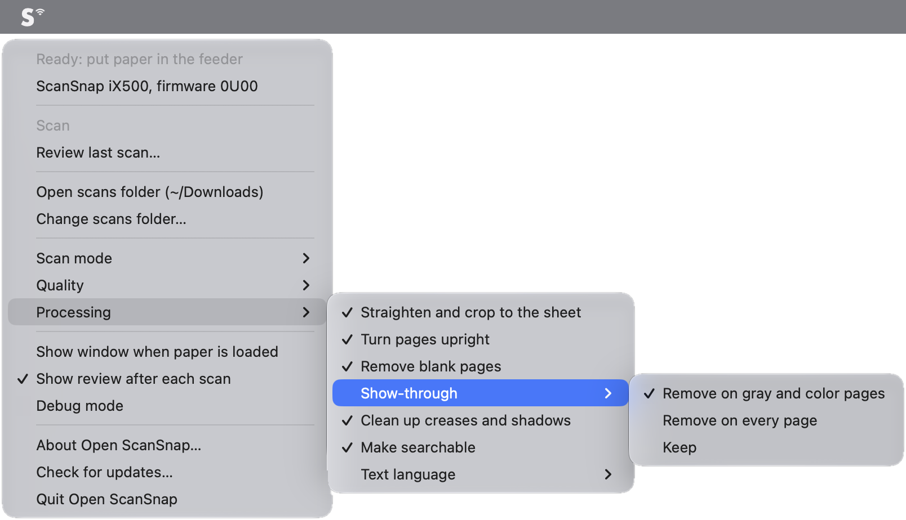

<p align="center"></p>

# Open ScanSnap

Scan from a ScanSnap iX500 on your Mac, over Wi-Fi or USB, without ScanSnap
Home.

<p></p>

## Features

- One searchable PDF per batch, made in the background while the next
  sheets scan.
- Straightened by the text on the page, cropped and turned upright; blank
  sides left out; text pages in black and white, color kept where there is
  color.
- The other side's print showing through the paper removed from gray and
  color pages (black and white pages drop it themselves), and fold shadows
  removed.
- Each page's language recognized, in 36 bundled languages.
- After a scan, any page can be stored another way (black and white, gray,
  color, photo, or left out) and the PDF updated in place.
- Wi-Fi or USB; sets up the scanner's Wi-Fi over USB.

## Install

Only one app can use the scanner at a time, and ScanSnap Home holds on to it
whenever it runs. Try Open ScanSnap first; remove ScanSnap Home once you're
happy:

1. **Quit ScanSnap Home**, the window *and* its icon in the menu bar
   (click it, then Quit). It starts again at login: after a restart, quit it
   again until you've removed it.
2. **Install Open ScanSnap**: download the
   [latest release](https://github.com/thomergil/open-scansnap/releases/latest),
   or:

   ```sh
   brew tap thomergil/tap
   brew trust --cask thomergil/tap/open-scansnap   # Homebrew asks before loading a cask from a tap
   brew install --cask thomergil/tap/open-scansnap
   ```

   A scanner already on your Wi-Fi network is found by itself; a new one can
   be put on it from **Set up Wi-Fi…** while plugged in over USB.
3. **Scan** a few batches and check the results.
4. **Remove ScanSnap Home** once you're happy, so it no longer starts at
   login and takes the scanner: drag it from Applications to the Trash, then
   run the uninstaller it leaves behind, **Applications ▸ ScanSnap Online
   Update ▸ Sub ▸ AOUUninstaller**. For a firmware update later, download it
   again from PFU.

Needs Apple silicon and macOS 13 or later.

## Supported scanners

| Scanner | Wi-Fi | USB |
|---|---|---|
| ScanSnap iX500 | ✅ confirmed | ✅ confirmed |
| ScanSnap iX1600 | ❓ | ❓ |
| ScanSnap iX1500 | ❓ | ❓ |
| ScanSnap iX1300 | ❓ | ❓ |
| ScanSnap iX100 | ❓ | ❓ |
| ScanSnap S1500 | no Wi-Fi | ❓ |

Over USB, Open ScanSnap scans through SANE, whose fujitsu backend supports
all of these, so they are likely to work. Over Wi-Fi, only the iX500's
protocol is known.

**Tried one of the ❓ scanners, or another ScanSnap?** Please
[tell me how it went](https://github.com/thomergil/open-scansnap/issues/new?title=Scanner%20report:%20)
(the model, Wi-Fi or USB, and what happened), so this list can say.

## FAQ

**The menu says the scanner is in use by another app.**
ScanSnap Home is running: quit it, including its icon in the menu bar.

**A page came out wrong, or one I need was left out.**
**Review last scan…**, pick **Store as** for the page, **Update PDF**. The
review window can open after every scan (**Show review after each scan**).

**Where is the last scan kept?**
In `~/Library/Application Support/open-scansnap/review`, readable only by
you, as the scanner sent it (about 7 MB per side), until the next scan.

**Characters or words are missing.**
Choose **Processing ▸ Show-through ▸ Keep** and
[report it](https://github.com/thomergil/open-scansnap/issues/new), with the
scan if you can share it. By default, show-through is removed only from
pages stored in gray or color: black and white pages drop faint
show-through by themselves.

**The scanner is not found.**
The iX500 turns on when its paper chute opens. Open ScanSnap also needs
**System Settings ▸ Privacy & Security ▸ Local Network**.

**Firmware updates?**
Not from Open ScanSnap: a failed update can leave the scanner unusable. The
menu shows ⚠ when newer firmware exists; update with ScanSnap Home.

## For developers

How it works, how to build it and run it from the command line:
[docs/DEVELOPMENT.md](docs/DEVELOPMENT.md).

## License

Open ScanSnap is MIT-licensed; see [LICENSE](LICENSE). The software it is
built on keeps its own licenses; their full texts are inside the app, in
`Open ScanSnap.app/Contents/Resources/Licenses`.

## Credits

[bramheerink/scansnap](https://github.com/bramheerink/scansnap) first worked
out the scanner's Wi-Fi protocol.

Open ScanSnap is built on this free software, all of it inside the app:

- **Scanning:** [SANE](https://gitlab.com/sane-project/backends)
  (sane-backends, GPL-2.0-or-later with the SANE exception; Open ScanSnap
  adds the ScanSnap's Wi-Fi to its fujitsu backend) and libusb.
- **Text recognition:** [Tesseract](https://github.com/tesseract-ocr/tesseract)
  with its [tessdata_fast](https://github.com/tesseract-ocr/tessdata_fast)
  language data, [Leptonica](http://www.leptonica.org/) (which also measures
  how far a page's text is turned), [OCRmyPDF](https://github.com/ocrmypdf/OCRmyPDF)
  and [py3langid](https://github.com/adbar/py3langid).
- **Images and PDFs:** [Pillow](https://python-pillow.org/),
  [NumPy](https://numpy.org/), [SciPy](https://scipy.org/),
  [scikit-image](https://scikit-image.org/),
  [img2pdf](https://gitlab.mister-muffin.de/josch/img2pdf),
  [pikepdf](https://github.com/pikepdf/pikepdf) with QPDF,
  [pypdfium2](https://github.com/pypdfium2-team/pypdfium2) with PDFium,
  fpdf2, fontTools, uharfbuzz with HarfBuzz, pdfminer.six, imageio, tifffile,
  libjpeg-turbo, libpng, libtiff, giflib, WebP and OpenJPEG.
- **The app:** [Python](https://www.python.org/),
  [PyObjC](https://github.com/ronaldoussoren/pyobjc),
  [Sparkle](https://sparkle-project.org/) (updates),
  [PyInstaller](https://pyinstaller.org/) (the app bundle), psutil, tomli-w,
  and Tesseract's compression libraries libarchive, xz, zstd, lz4 and libb2.
- **Their Python dependencies:** annotated-types, attrs, cffi,
  charset-normalizer, cryptography, jsonschema, jsonschema-specifications,
  lazy-loader, lxml, markdown-it-py, mdurl, networkx, packaging, pluggy,
  pycparser, pydantic, pydantic-core, Pygments, referencing, rich, rpds-py,
  typing-extensions and typing-inspection.

ScanSnap and ScanSnap Home are trademarks of PFU Limited, a Ricoh company.
Open ScanSnap is not affiliated with or endorsed by PFU or Ricoh. Mac and
macOS are trademarks of Apple Inc.
